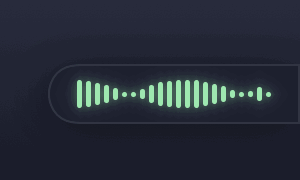
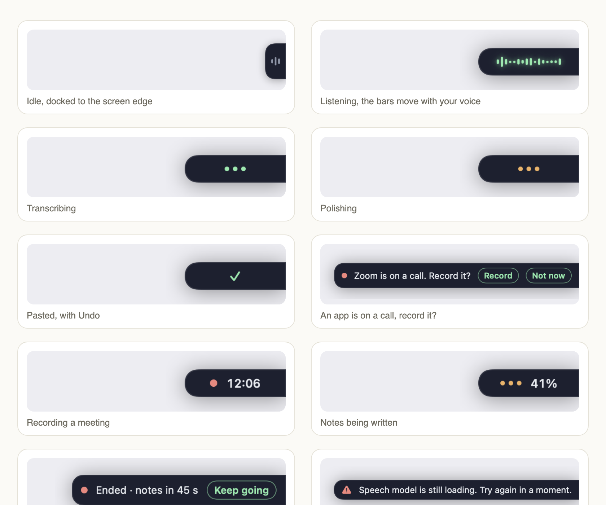

<p align="center">
  
</p>

<h1 align="center">Speakhold</h1>

<p align="center">
  <strong>Hold a key, talk, let go. Your words land wherever your cursor is.</strong><br>
  Free, open-source dictation and meeting notes for macOS, in native Swift. Whisper runs on your Mac; your audio never leaves it. Add a Claude key only if you want it writing the notes.
</p>

<p align="center">
  <a href="https://github.com/sturzael/speakhold/releases/latest"></a>
  <a href="https://github.com/sturzael/speakhold/actions"></a>
  <a href="LICENSE"></a>
  
  <a href="https://github.com/sturzael/speakhold/stargazers"></a>
</p>

<p align="center">
  
</p>

Speakhold is a push-to-talk voice typing tool for Mac, built as a free replacement for **Willow Voice**, **Wispr Flow**, **Superwhisper** and **MacWhisper**-style dictation. It is a single native Swift binary, a couple of megabytes, no Electron, no account, no subscription.

## Why Speakhold

- **100 % on-device.** Speech-to-text runs with [WhisperKit](https://github.com/argmaxinc/WhisperKit) on the Apple Neural Engine. Works offline. Your audio never touches a server.
- **Any hotkey chord, left and right aware.** Hold *left ⌃ + left ⌥* (default), *right ⌥* alone, *fn*, or add an F-key. Hold-to-talk or press-to-toggle.
- **Pastes anywhere.** Slack, Gmail, Xcode, Terminal, Notes, your browser: wherever the cursor is.
- **Words as you speak.** A small tab docked to the right edge of the screen opens into a bar that shows the transcript live while you hold the key, Willow-style. Release and it lands at the cursor. Esc cancels. **Undo** sits on the bar for three seconds after a paste; **Try again** re-runs the last recording if it failed.
- **Hands-free when you need it.** Tap Space while holding the chord and let go; Speakhold keeps listening until you press the chord again.

<p align="center">
  
</p>

- **Polish on your Mac.** On macOS 26 with Apple Intelligence, Speakhold strips "um"s, fixes punctuation and spells the names in your personal dictionary correctly, on-device, no key, nothing sent anywhere. Prefer Claude? Add your API key and pick it under Cleanup. Either way, spoken commands ("new paragraph", "full stop", "comma", "question mark") always work, text replacements (`my email -> you@…`) run last, and the raw transcript is pasted if a model fails or wanders.
- **Takes the minutes.** "Record meeting" captures both sides of a Zoom, Meet or Teams call on your Mac, no virtual audio driver and no bot. It transcribes on the Neural Engine with you and each far-side voice labelled, folds in the notes you typed during the call and the moments you marked, names the meeting from your calendar, writes Summary / Decisions / Action items / Open questions (and a follow-up email if you want one) and saves one markdown file. "Catch me up" shows the last two minutes when you drifted. Speakhold offers to record when it notices an app on a call. The notes are written in the background after you stop (menu bar shows progress, a notification opens the file), so dictation never waits. Files go to `~/Documents/Speakhold Meetings` or a folder you choose. **Add a Claude key for the notes**: it reads the whole transcript. Without one, Apple Intelligence writes them on-device in parts, which is fine for a short call and weak on a long one. Audio never leaves the Mac either way.
- **Notes by Claude without an API key.** Have Claude Code installed and the meeting notes go through it under your own Claude plan. Otherwise add an API key, or let Apple Intelligence write them on-device.
- **Scriptable.** `Speakhold --toggle` (or `open speakhold://toggle`) talks to the running app: `--start`, `--stop`, `--cancel`, `--settings`, `--history`. Wire it to SketchyBar, Raycast or a Shortcut.
- **Native and tiny.** Swift + SwiftUI + AppKit. Menu-bar only. Launch at login. History window with one-click copy.

## Install

**Download:** grab `Speakhold.app.zip` from the [latest release](https://github.com/sturzael/speakhold/releases/latest), unzip, drag to Applications.
The app is not notarized yet, so the first launch needs a right-click → **Open**, or:

```bash
xattr -dr com.apple.quarantine /Applications/Speakhold.app
```

**Homebrew:**

```bash
brew install --cask sturzael/tap/speakhold
```

**Build from source** (Xcode 16+ / Swift 5.10+, Apple Silicon):

```bash
git clone https://github.com/sturzael/speakhold.git
cd speakhold
./build.sh          # → ~/Applications/Speakhold.app
open ~/Applications/Speakhold.app
```

## First run

1. Click the waveform icon in the menu bar → **Settings → Permissions**.
2. Grant **Microphone** and **Accessibility** (Accessibility is what lets a menu-bar app see the hotkey and paste for you).
3. The speech model (~630 MB) downloads once in the background. Status shows **Ready** when it is loaded.
4. Click into any text field, hold **left ⌃ + left ⌥**, speak, release.

## Settings

| Tab | What you can change |
|---|---|
| **General** | Hotkey: click Record and press the keys you want (any mix of left/right ⌃ ⌥ ⇧ ⌘, fn, plus an optional F-key), hold vs toggle, microphone picker with a 3 s test, Whisper model (Large v3 Turbo, Large v3, Distil, Base), language, bar position (right edge / bottom right / bottom centre), idle tab on/off, sounds, launch at login |
| **Cleanup** | Polish engine: Apple Intelligence (on-device, default on macOS 26) / Claude / off; the Claude key and model (polish, and meeting notes when Claude Code is not installed; or `ANTHROPIC_API_KEY`); personal dictionary; text replacements; style notes |
| **Meetings** | Offer to record when an app starts a call, title and invitees from Calendar, transcription engine (Whisper / Parakeet), tell the far-side voices apart, which engine writes the notes (Claude with a key, otherwise on-device), follow-up email draft, where the files save |
| **Permissions** | Microphone and Accessibility status with one-click prompts |

## How it compares

| | Speakhold | Willow Voice | Wispr Flow | Superwhisper | Handy |
|---|---|---|---|---|---|
| Price | Free, MIT | US$12–15/mo | US$12–15/mo | US$8.49/mo or lifetime | Free, MIT |
| Audio stays on device | Yes | Cloud by default | Cloud | Yes | Yes |
| Native Swift (no Electron/Tauri) | Yes | — | — | Yes | No (Tauri) |
| Left/right-specific modifier chords | Yes | No | No | Partial | No |
| AI cleanup with personal dictionary | Optional (your key) | Yes | Yes | Yes | No |
| Open source | Yes | No | No | No | Yes |

Prices and features as of October 2026; corrections welcome via PR.

## Privacy

Audio is captured with AVAudioEngine, converted to 16 kHz mono, transcribed in-process and discarded. Polish runs on-device through Apple Intelligence. The only network call Speakhold can make is the Claude polish engine, and only if you choose it and provide a key. There is no telemetry, no analytics, no update check.

## Contributing

Issues and PRs are welcome. See [CONTRIBUTING.md](CONTRIBUTING.md) for the layout, how to run the headless checks (`--transcribe`, `--test-hotkey`, `--render-overlay`) and the roadmap.

## Credits

Built on [WhisperKit](https://github.com/argmaxinc/WhisperKit) by Argmax. Made in Wellington, New Zealand by [Wild Interactive](https://wildinteractive.co.nz).

## License

[MIT](LICENSE)
